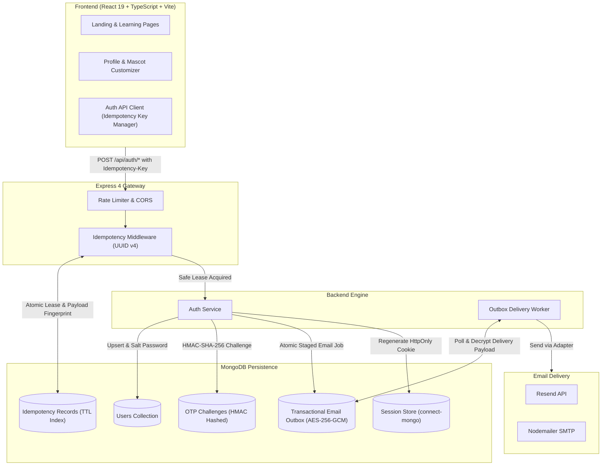

# 🤖 AI Playground & Enterprise Email OTP Authentication Platform

> A production-ready educational web platform introducing young learners (ages 5–10) to foundational artificial intelligence concepts, paired with an enterprise-grade, cryptographically secure **Email OTP & Password Authentication System** featuring strict **End-to-End Idempotency Key** protection and an **AES-256-GCM Transactional Outbox**.

---

## 🌟 Architecture Overview



---

## 🚀 Key Features

### 1. Child-Safe Interactive AI Learning
- **Tailored Learning Bands**:
  - 🧭 **AI Explorer (Ages 5–6)**: Pattern recognition, sorting helpers, and curiosity-driven exploration.
  - 🔍 **AI Detective (Ages 7–8)**: Data labeling, identifying training vs. testing examples, and spotting mistakes.
  - 💡 **AI Creator (Ages 9–10)**: Training miniature classifiers, model limitations, and ethical decision-making.
- **Interactive Lessons & Quizzes**:
  - Hands-on sorting activities, pattern puzzles, and interactive multiple-choice checkpoints with constructive feedback.
- **Guided AI Lab**:
  - Interactive mini-classifier allowing children to label training data, train a model, and test unseen samples to understand prediction confidence.
- **Profile & Robot Mascot Customizer**:
  - Select robot companion expressions (`happy`, `celebrating`, `curious`, `thinking`).
  - Custom Explorer Nickname saved locally for certificates and badges.
  - 1-click Learning Band level switcher.
- **Badges & Achievement Shelf**:
  - Celebration animations (confetti) and progress tracking across all learning modules.
- **Responsive Full-Screen Design**:
  - Enhanced widescreen layout supporting up to `1720px` viewports, avoiding awkward gutters on large monitors while providing responsive scaling on tablets and phones.

---

### 2. Enterprise Authentication & Security
- **Cryptographic Email OTP Engine**:
  - 6-digit random codes generated via Node.js `crypto.randomInt(100000, 1000000)`.
  - Plaintext OTPs are **never stored**; hashed with `HMAC-SHA-256` using `OTP_HMAC_SECRET`.
  - Constant-time verification with `crypto.timingSafeEqual` prevents timing attacks.
  - Brute-force protection: Maximum 5 failed attempts per challenge before permanent lock.
  - Automatic expiration (5 minutes) and 60-second resend cooldown.
  - Zero account enumeration: `send-otp` returns identical responses regardless of email existence.
- **Parent Registration & Password Authentication**:
  - Parent/Guardian registration capturing Full Name, Contact Phone, Normalized Email, and bcrypt-salted Password (`bcryptjs`).
- **Mandatory End-to-End Idempotency**:
  - State mutations require a valid `Idempotency-Key` (UUID v4 format).
  - Scope isolation: `scopeHash = HMAC(clientId : canonicalRoute)`.
  - Prevents race conditions with atomic MongoDB compound indexes on `{ scopeHash: 1, key: 1 }`.
  - In-flight request concurrency lock returns `409 Conflict` with `Retry-After: 2`.
  - Payload tampering detection rejects altered payloads with `422 Unprocessable Content`.
- **Transactional Outbox Email Delivery**:
  - OTP challenge creation and email delivery payloads are committed together.
  - Payloads are encrypted at rest using **AES-256-GCM** authenticated encryption (`EMAIL_ENCRYPTION_KEY`).
  - Asynchronous background worker handles delivery with exponential backoff and swappable adapters (**Resend**, **SMTP / Nodemailer**, **Test Logger**).
- **Session Management**:
  - Server-side sessions backed by MongoDB via `connect-mongo`.
  - Session fixation protection: Regenerated immediately upon verification.
  - Cookies configured with `HttpOnly`, `SameSite=lax` (or `none` in production), and `Secure`.
  - Zero authentication tokens stored in `localStorage` or `sessionStorage`.

---

## 🛠️ Project Directory Structure

```text
ai_playground_project_docs/
├── backend/
│   ├── src/
│   │   ├── config/             # Environment schemas (env.ts), Database connection (database.ts)
│   │   ├── controllers/        # AuthController (register, login, sendOtp, verifyOtp, me, logout)
│   │   ├── middleware/         # Idempotency, RequireAuth, RateLimiters, ErrorHandler
│   │   ├── models/             # UserModel, OTPChallengeModel, IdempotencyRecordModel, EmailOutboxModel
│   │   ├── routes/             # Express API routes (/api/auth/*)
│   │   ├── services/           # AuthService, IdempotencyService, EmailService, Adapters (Resend, SMTP, Test)
│   │   ├── workers/            # EmailOutboxWorker (AES-256-GCM background delivery worker)
│   │   ├── utils/              # Crypto (HMAC, timingSafeEqual, AES), Logger, Fingerprint
│   │   ├── validators/         # Zod schemas (Email normalization, OTP, UUID v4, Registration)
│   │   ├── types/              # TypeScript session and model declarations
│   │   ├── docs/               # OpenAPI 3.0 specification (openapi.json)
│   │   ├── app.ts              # Express app factory with CORS and Swagger UI
│   │   └── server.ts           # HTTP server bootstrapping and graceful shutdown
│   └── tests/
│       ├── unit/               # Crypto, validation, and secret redaction tests
│       ├── integration/        # Registration, login, and OTP lifecycle integration tests
│       ├── security/           # Brute force, timing resistance, and enumeration tests
│       └── concurrency/        # Concurrent race conditions and key collision tests
├── src/                        # Frontend React 19 Application
│   ├── app/                    # App root shell and React Router configuration
│   ├── assets/                 # Icons, mascots, and illustrations
│   ├── components/
│   │   ├── auth/               # OtpInput, CooldownTimer, ProtectedRoute
│   │   ├── ui/                 # RobotMascot, ProgressBar, BadgeCard, Buttons, SafetyNotice
│   │   ├── layout/             # SiteHeader (with Profile Dropdown), SiteFooter, PageContainer
│   │   ├── learning/           # LearningBandCard, ActivityCard
│   │   ├── lesson/             # LessonPlayerView, SortingActivity, PatternActivity, QuizQuestion
│   │   └── lab/                # LabView (Interactive ML Classifier Playground)
│   ├── context/                # AuthContext (session state, user profile, auth actions)
│   ├── data/                   # Lessons, Learning bands, Badges, Lab samples
│   ├── hooks/                  # useProgress hook (local state subscription)
│   ├── pages/                  # LandingPage, DashboardPage, ProfilePage, LessonsPage, LabPage...
│   ├── services/               # authApi client, progressService, storage
│   └── types/                  # Frontend TypeScript types and interfaces
├── package.json                # Root package configuration and unified workspace scripts
├── vite.config.ts              # Vite configuration with Tailwind CSS
└── README.md
```

---

## 💻 Getting Started

### Prerequisites
- **Node.js**: `v20.x` or higher
- **npm**: `v10.x` or higher
- **MongoDB**: A running MongoDB instance (Local or Atlas Replica Set)

---

### 1. Installation

Clone or extract the repository, then install dependencies for both the frontend and backend:

```bash
# Install frontend root dependencies
npm install

# Install backend dependencies
npm --prefix backend install
```

---

### 2. Environment Configuration

Copy the example environment files:

#### Backend Configuration:
```bash
cp backend/.env.example backend/.env
```
Edit `backend/.env` with your configuration:
```env
PORT=3000
NODE_ENV=development
FRONTEND_URL=http://localhost:5173
MONGO_URI=mongodb://127.0.0.1:27017/ai_playground

# At least 32 characters
SESSION_SECRET=your_super_secret_session_key_at_least_32_characters_long
OTP_HMAC_SECRET=your_super_secret_otp_hmac_key_at_least_32_characters_long
IDEMPOTENCY_HMAC_SECRET=your_super_secret_idempotency_hmac_key_at_least_32_characters_long
EMAIL_ENCRYPTION_KEY=01234567890123456789012345678901

# Email Provider ('resend', 'smtp', or 'test')
EMAIL_PROVIDER=resend
RESEND_API_KEY=re_your_api_key_here
EMAIL_FROM=AI Playground <auth@yourdomain.com>
```

#### Frontend Configuration:
Create `.env` in the root folder:
```bash
cp .env.example .env
```
Ensure the API base URL is set:
```env
VITE_BACKEND_API_URL=http://localhost:3000
```

---

### 3. Running in Development

You can run both services independently or together:

#### Option A: Unified Scripts (from root)
```bash
# Start backend API (Port 3000)
npm run dev:backend

# Start frontend application (Port 5173) in a second terminal
npm run dev:frontend
```

#### Option B: Dedicated Folders
```bash
# In terminal 1:
cd backend
npm run dev

# In terminal 2:
npm run dev
```

Visit the frontend at **`http://localhost:5173`** and the API at **`http://localhost:3000`**.

---

## 📡 API Reference & Documentation

Interactive OpenAPI 3.0 documentation with Swagger UI is available at:
**`http://localhost:3000/api/docs`**

| Method | Endpoint | Description | Idempotency Required |
| :--- | :--- | :--- | :---: |
| `POST` | `/api/auth/register` | Register parent account (Name, Phone, Email, Password) | ✅ Yes |
| `POST` | `/api/auth/login` | Authenticate with Email & Password | ✅ Yes |
| `POST` | `/api/auth/send-otp` | Request a 6-digit Email OTP challenge | ✅ Yes |
| `POST` | `/api/auth/verify-otp` | Verify 6-digit OTP code & start authenticated session | ✅ Yes |
| `POST` | `/api/auth/resend-otp` | Request a fresh OTP (guarded by 60s cooldown) | ✅ Yes |
| `GET` | `/api/auth/me` | Fetch currently authenticated user session details | ❌ No |
| `POST` | `/api/auth/logout` | Terminate session and clear HttpOnly cookie | ✅ Yes |

### Required Mutation Headers:
```http
Content-Type: application/json
Idempotency-Key: 8a4b86e0-2441-477d-8951-6dfba57c43df
```

---

## 🧪 Testing & Quality Assurance

Both frontend and backend suites are powered by **Vitest**:

```bash
# Run all test suites (Frontend + Backend)
npm run test:all

# Run frontend tests only
npm run test:frontend

# Run backend tests only
npm run test:backend

# Run linter
npm run lint
```

### Production Build Verification:
```bash
# Build frontend production bundle
npm run build:frontend

# Build backend TypeScript
npm run build:backend
```

---

## 🛡️ Child Safety & Privacy Principles

1. **Zero Child Data Collection**: No real names, school names, physical addresses, or photos of children are ever collected or stored.
2. **Local Client Evaluation**: AI learning activities, sorting puzzles, and lab classifications run locally inside the browser.
3. **No Unmoderated Chatbots**: Lessons use curated, sandboxed educational simulations instead of open-ended conversational models.
4. **Parental Authority**: Session creation, account credentials, and data retention preferences are governed strictly by parent/guardian authorization.

---

## 📄 License

This project is licensed under the **MIT License**.
